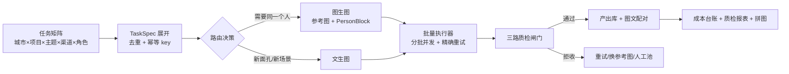

# 项目史（实施计划 + 两次评审的合并存档）

> 这份文档把三份**同一时期**的历史材料合并成一份，方便后来者按时间线读：
> 最初的技术计划（`PLAN.md` v1.5）、产品化/架构审计（`AUDIT-product-20261024.md`）、
> 第三方独立评审（`REVIEW-trae-20261024.md`）。
> 本项目最初以最小可行产品（MVP）立项，验证"质量是闸门问题而非模型问题"这条主张；后转向按开源产品的交付标准推进。
>
> **读法**：
> 1. 三份材料写于 2026-10-24 前后，**基线各不相同**（测试数分别记 62 / 129 / 125），
>    文中数字一律按**当时**的基线保留原样，不回填成现在的数字——它们是证据，不是活页。
> 2. 目录里的每个 `#` 标题都是**原文标题降级一级**后的结果；正文除发布前脱敏与语境中性化外，技术内容一字未改。
> 3. 每部分内部的「第 N 节」指该部分原文的第 N 节（对应本文 §1.N / §2.N / §3.N）。
> 4. **这些意见现在的状态**看 §4 现状索引；**裁决过程**的结论已并入本文 §4 各条目。
>
> 合并日期：2026-10-24 之后的第一次整合（本次）。
> 原始三份文件已删除（内容已全部并入本文，本仓库历史中不含这三份文件）。

---

## 0. 三份材料的关系

| 部分 | 原文 | 作者视角 | 基线 | 在本文的位置 |
|---|---|---|---|---|
| 实施计划 | `PLAN.md` v1.5 | 自己写自己的计划（立项自述视角） | 62 项测试 | §1 |
| 产品化/架构审计 | `AUDIT-product-20261024.md` | 第三方按"要真用"的标准评 | 129 项测试 | §2 |
| 第三方独立评审 | `REVIEW-trae-20261024.md` | 第三方按"可交付"的标准评 | 125 项测试 | §3 |

三份材料互相独立成文，但结论高度一致：**问题不在模型能力，在工程化收尾**。
两份评审给出的 P0/Must-fix 清单几乎逐条重合（并发、鉴权、发布回流、场景解耦），
而这些条目后来多数被采纳并落地——落地记录见本文 §4。

---

## §1 实施计划（PLAN.md v1.5）

## 医美 AI 图文内容生产闭环 · MVP 项目 · 技术计划

> 版本 v1.5 ｜ 2026-10-24 ｜ 作者：项目立项者
>
> **本轮交付边界**：只交付本计划文档 + 已跑通的实测证据（`evidence/`）。**不写实现代码**，实现按第 6 节里程碑推进。
> **计划前提**：第 2 节所有条目均为本机实测结论，非假设；凡未实测处一律显式标注为「待测」或「工作假设」。
>
> ---
>
> ## v1.5 变更记录（外部复审后的复核与修正 —— 数字全部重测，不做"措辞修补"）
>
> 复审指出三处会被追问穿的问题。**结论先行：三处都属实，且其中两处的根因比复审猜的更深**——
> 顺着查下去发现了一个更底层的原因（通道顺序），它把"分布重叠"这件事的性质改了。
>
> | 复审意见 | 复核结论 | 处理 |
> |---|---|---|
> | P1-1 人物任务"画面里没人脸"会被放行 | ✅ 属实 | 新增硬规则：人物任务**必须检出人脸**才放行（`missing_face_reason`）；"检不到"≠"合格" |
> | P1-2 多脸图取错脸，"分布重叠"可能是假象 | ✅ 机制属实，但**结论要改的不是"阈值没用"而是"阈值在生成图口径上没用"** | 选脸改为**与参考照最相似的一对**（gallery 语义），qc 与 faceswap 两处一起改；重测后：真人照片口径 0.6551 vs 0.3463 **可分**，生成图口径才重叠 → 根因是**生成方差** |
> | P1-2 附带发现 | 🔥 **更底层的根因**：insightface 期望 **BGR**，质检链路传的是 PIL 的 **RGB** → 一张大笑的人脸特写被整张判成"无人脸"，身份校验整段跳过 | 统一转 BGR（`tools/check_channel_order.py` 可复现），回归测试锁住 |
> | P1-3 依赖没装时 CLI 与面板同时不可用 | ✅ 属实（我原先只考虑了"fastapi 缺失"，没考虑"整套依赖都缺"） | 面板依赖改为**可选 extra**（`pip install -e ".[panel]"`）；`cli.py` 入口加依赖预检，缺依赖时给可执行提示而不是裸 `ModuleNotFoundError` |
> | P2 `calibrate-face` 不是真标定 | ✅ 属实 | 改成**三组分布查看器**（A 同一人真人 / B 不同人 / C 同一人生成图），并写明 n=4 属自洽性验证、阈值未标定 |
> | P2 路由理由里写死数字 | ✅ 属实 | 规则文本只说"往哪边走 + 依据哪个口径"，数字去台账和 README 查（写死必漂） |
> | P3 文档数字与 G4 样本量 | ✅ 属实 | 全部数字按新口径重测重写；G4 表标注 **n=1**，只当量级参考 |
>
> **本轮唯一没被推翻的结论**：一致性必须用**确定性**方式施加（后置换脸），且**与后端无关**
> ——换脸后两条路线收敛到 0.7250~0.9023。**理由改了，方案没变。**
>
> ---
>
> ## v1.4 变更记录（G1~G4 缺口补齐：自动路由 / 成本账 / 写实 checkpoint / Web 面板）
>
> | 项 | 状态 | 依据 |
> |---|---|---|
> | **G1 自动路由** | ✅ 已实现 | 规则表 R1~R4（合规 > 排版 > 一致性 > 成本），决策理由（rule_id + reason）落台账；`generate --provider auto` 逐条任务分流，本轮实测 8 张 = API 4 + 本地栈 4 |
> | **G2 Web 面板** | ✅ 已实现（用户已拍板） | FastAPI + 单页静态前端（零 CDN）：任务提交 → 后台跑「生成→质检→换脸→报表」→ 画廊逐张查质检明细/路由理由/成本。**薄壳**：读走台账、写走 CLI 子进程，流水线逻辑只有一份 |
> | **G3 成本账** | ✅ 已实现 | 口径「单张**合格**图综合成本 = 总花费 ÷ 合格张数」（返工也算钱）；单价走环境变量，未配时显示"未配置单价"，**不编造金额** |
> | **G4 本地栈真实感** | ✅ 写实权重已下完并跑出并排对照图 | HF CDN 掐断用 32MB 分块 Range 下载绕过（`tools/fetch_photo_model.py`）；`tools/compare_photo_vs_turbo.py` 同 prompt/同 seed 出 turbo vs 写实 checkpoint 对照图。**真实感优劣待用户盲评**（主观验收项，工具只出素材） |
> | 回归测试 | ✅ 55 项全过 | 新增面板 API 冒烟 6 项 |
>
> ---
>
> ## v1.3 变更记录（对另一份 MVP 方案 V2 的逐条裁决）
>
> 另一份方案（API + 本地双轨，ComfyUI + PuLID + FastAPI 面板）与我方实现做了差异对照。
> **结论先行**：它的主张没有偏离，但有两处技术判断我方更硬，一处规则需要改写，一处形态变更需要拍板。
>
> | 差异项 | 裁决 | 依据 |
> |---|---|---|
> | 一致性机制改用后置换脸 | **采纳（已在上一轮落地）** | 实测证伪了阈值判别力（同一人 0.24~0.83、不同人 0.18~0.40 分布重叠），确定性换脸比概率阈值更硬 |
> | API 后端是托管连接器（不是 Seedream） | **不采纳改选型，但补上"公司能用哪个"的话术** | 本机可跑通已验证；选型建议写在交付说明里，不编造报价 |
> | 本地栈 SDXL-Turbo 4 步、无 PuLID | **接受事实，本轮补齐一半** | 采样参数已改成可配（turbo / photo 预设），写实 checkpoint 对比工具已就绪；PuLID 本轮未做，结论待实测 |
> | **"含中文排版的封面 → 走 API"** | **规则要改写** | 实测 **API 也会把中文画成乱码招牌**（`evidence/batch/`），所以正确形态是「中文一律不在画面渲染、由后处理合成」，路由上只体现为"画面干净度要求高 → 走 API" |
> | provider 由命令行手选（缺自动路由） | **本轮补齐** | 原始需求原话是"由系统按任务自动调用模型"——已实现有序规则表 R1~R4，决策理由落台账 |
> | 成本账缺位（单价留空） | **本轮补齐模型，单价仍不编造** | 口径定为「单张**合格**图综合成本 = 总花费 ÷ 合格张数」，返工也算钱；单价走环境变量，未配置时显示"未配置单价" |
> | 无 Web 面板 | **待拍板**（形态变更 + 新增依赖） | 见第 10 节决策清单 D8 |
>
> ---
>
> ## v1.2 变更记录（复审后修机制，不是修文档措辞）
>
> | 复审发现的问题 | 处理 |
> |---|---|
> | **阈值口径自相矛盾**：README 说"阈值只作提示"，代码却在用这个阈值拦图（0.2403 被拒） | 判定**分两阶段**：生成阶段身份分**只标记漂移不拦截**，出厂判定放到**换脸后复检**（`should_reject_on_identity(result, phase)`） |
> | **换脸产物命名空间冲突**：两条线共用同一幂等键，磁盘上互相覆盖（DB 复合主键不冲突，磁盘会冲突） | 换脸产物与回放缓存都按 `provider` 分目录；台账每行指向自己那一份，已用 MD5 逐一核对 |
> | **回放缓存不随仓库走**：`out/`、`data/*.db` 被 gitignore，新 clone 上"幂等证明"和"断网回放"两步直接失效 | 导出 `fixtures/`（压缩 JPEG + 缓存）并提交；新 clone 实测两条路线各复现 6/4 张 |
> | **本地栈与 V2 计划的偏差**：最终是 SDXL-Turbo 4 步、无 PuLID/IP-Adapter | 写进 README 第 6 节"路线边界"：**真实感上限低**、一致性全靠后置换脸、虚拟人身份资产须用授权模型 |
> | **耗时语义没说清**：API 的 `gen_seconds` 是批内均摊，两张一模一样 | CLI 输出、CSV 表头都标注语义（API=批内均摊 / 本地栈=单张实测） |
>
> ---
>
> ## v1.1 变更记录（实施阶段回写，实测推翻的原假设）
>
> | 原计划假设 | 实测结果 | 处理 |
> |---|---|---|
> | 「本机无 GPU 训练/推理条件」 | **有 RTX 4070 Laptop 8GB**；CUDA torch 2.14.1+cu130 可用；SDXL-Turbo 本地栈已跑通 | 本地栈从"v2 备选"升为**已交付的第二条路线**；LoRA 训练仍不做（8GB 显存 + 工期不够） |
> | 「阈值需用外部标注样本标定」 | 已标定：标定样本上同一人 0.6471、不同人 0.1809~0.3956 可分；但**流水线自产的"同一人"只有 0.24~0.83**，与负样本分布重叠 | 阈值在**生成阶段**降级为"标记"（不拦截），**出厂判定改由后置人脸替换兜底**（最差一张 0.2403 → 0.6898） |
> | 「文案用模板占位」 | 已按此实现，并加了**否定语境识别**（"不保证疗效"不该被拦） | 保持模板；禁用词闸升格为可配置闸门 |
> | 未预见 | CLI 是 `.cmd` → Python 子进程 `WinError 2`；台账 `INSERT OR REPLACE` 会把未传字段写成 NULL | 已抽 `cli_runner.py`；台账改 `ON CONFLICT DO UPDATE` + 加列迁移 |
>
> 四个决策已定：**Python / API+本地栈双线 / 模板文案 / 现场跑+录屏兜底**（见第 10 节）。

---

### 1. 立项需求与技术主张（这是本项目的全部意义）

> 原始需求：*「文生图和图生图都可能用，MVP 不预设只做一种，重点是如何选模型和组织流程，保证真实感、人物一致性，并由系统按任务自动调用模型批量产出指定城市、项目、主题的图文。」*

**一句话主张**：

> **人物一致性不是提示词问题，是路由问题。**同一套提示词在文生图路径上每次换脸；把同一张定妆照作为参考图喂进图生图路径，人脸能被稳定锁住。所以我的 MVP 不是「选一个模型」，而是**按「是否需要同一个人」把任务分流到两条路径，再用三道自动闸门决定产出能不能出厂**。

**支撑证据（本机实拍，已归档在 `evidence/`）**：

| 图 | 生成方式 | 结果 |
|---|---|---|
| `evidence/01_t2i_baseline.png` | 文生图（基线人物） | 写实度达标，作为**定妆照/参考图** |
| `evidence/02_i2i_same_person.jpg` | **图生图**：以 01 为 `input_urls`，换服装换场景 | **同一个人的脸**，发型/脸型/颧骨/面部痣位一致 |
| `evidence/03_t2i_same_description_differs.png` | 文生图：只用文字描述同一角色（含"左颊有痣"） | **明显是另一个人**，五官比例全变 |

两张对照图放在一起，比任何架构图都直观——这直接回答了"如何选模型"这一立项问题。

**"项目是否真实可跑"**：见第 9 节，本项目的可跑仓库与 `evidence/` 实测产出本身就是最强的一次性证据。

---

### 2. 已实测的事实基线（计划的地基）

以下全部为本机 2026-10-24 实测，不是文档推测。

| # | 事实 | 证据来源 |
|---|---|---|
| F1 | 生图后端**真实可用**：文生图与图生图同一接口，`input_urls` 传参考图 | 3 次调用全部 `code:0` |
| F2 | **批量能力**：一次调用 `requests[]` 传 6 个城市/项目/主题组合，**6/6 成功**，墙钟 **45.2 秒**（≈7.5 秒/张） | `evidence/batch/` 6 张 |
| F3 | 失败项与成功项**分离返回**（`success_items[]` / `failed_items[]`），支持精确重试 | 调用返回体 |
| F4 | **图生图能锁人脸**；纯文生图锁不住 | `evidence/01~03` |
| F5 | 接口**没有 strength / weight / denoise 参数** → 参考图强度不可调 | 接口 `input_schema` 全量字段 |
| F6 | 可选 `aspect_ratio`：1:1 / 16:9 / 9:16 / 4:3 / 3:4 / 21:9；`resolution`：1K / 2K / 4K | 接口 schema |
| F7 | `output_file` 只认 basename，**扩展名由服务端决定**（实测 `.png` 入参返回 `.jpg`） | 调用返回 `file_name` |
| F8 | **主题词会被画进画面**：实测出现黑板「价格透明拆解」、平板「45岁 松弛肌」、桌面名牌乱码、证书「荣誉证书」+乱码 | `evidence/batch/` 4 张肉眼 |
| F9 | **VLM 质检可用但会漏检**：能读出乱码文字（`10�?4日`），却判定 `garbled:false`、`worst_issue:"无明显问题"` | `describe_images` 实测返回 |
| F10 | 本机**无 LLM 连接器**（连接器目录仅图像/视频/音频/视觉理解/图片搜索），但 `config.yaml` 有 `provider` 配置 → 文案可走本机 provider 或公司自有栈 | 连接器目录清单 |
| F11 | Pillow 12.3.0 已装 → 拼图/裁切/水印/通道配比后处理零新增依赖 | `python -c "import PIL"` |
| F12 | 运行环境：Python 3.14.8 / Node 24.21 / git 2.56；工作区为**空目录、未初始化 git** | 环境探测 |
| F13 | **GPU 存在**：RTX 4070 Laptop 8GB（8188MiB），驱动 617.42；CUDA torch 2.14.1+cu130 可用（sm_89） | nvidia-smi + CUDA 实跑 |
| F14 | 本地栈 SDXL-Turbo fp16（6.9GB）实测：**offload 模式 T2I 5.62s / 峰值 5.07GB**（塞得进 8GB）；全量上卡 54.01s / 10.49GB（超显存会 OOM） | 本地栈实测 |
| F15 | **身份阈值在「生成图 vs 定妆照」口径上不具判别力 —— 但不是模型分不出人**：同一人的**真人照片**（人工 I2I）**0.6551**、不同人 0.3463 / 0.4364 / 0.4429（**可分**）；而**同一人的生成图**只有 0.3767 / 0.4992，**掉进不同人的区间**。→ 根因是**生成方差**（姿态/光照/构图/风格/清晰度混进分数），不是阈值本身 | `calibrate-face` 三组分布（v1.5 口径修正后重测） |
| F16 | **判定必须分两阶段**：生成阶段身份分只标记「⚠漂移」不拦截；出厂判定放在**换脸后复检**（`phase="generate"` 永不因身份分拒收，`phase="post_swap"` 才按阈值拒收） | 机制修复 + 本轮回归 |
| F17 | 流水线实测吞吐：2K 图 I2I 2 张 40.5s、T2I 2 张 38.5s（≈19~20s/张，含下载；1K 批量实测 6 张 45.2s ≈ 7.5s/张） | 真实调用计时 |
| F18 | 三个工程坑：① `mcode-tools` 是 `.cmd`，Python subprocess 列表模式 `WinError 2`；② `--args '<json>'` 内联必坏，须 `--args-file`；③ `INSERT OR REPLACE` 局部更新会把未传列写成 NULL | 实施中实测 |
| F19 | **采样参数不是身份分的主要杠杆**：固定 seed、n=1/配置，steps 4~12 / strength 0.25~0.45 / prompt 长短共 5 组配置，身份分只落在 **0.4462~0.5012**；同配置短 prompt 0.4462 vs 长 prompt（身份在前）0.4549，差异在噪声量级。⚠️ 早先"身份块前置把相似度从 0.1469 提到 0.4284"的说法**过度解读**了该实验（它并没有隔离该变量），**已撤回**。CLIP 77 token 截断是真事实（worker 已按 token 裁剪），但那是**必须处理的坑**，不是提分杠杆 | `tools/sweep_local_i2i.py` 重跑（v1.5） |
| F20 | **后置换脸把两条路线都收敛到同一区间**：API 0.3767→**0.8787**、0.7350→0.8914、0.6144→0.8827、0.6751→0.8946；本地栈 0.4992→**0.9023**、0.2611→**0.7250**（**后处理与后端无关**，换脸后落在 0.7250~0.9023） | `faceswap` 实测（v1.5 口径） |
| F21 | 端到端回归：8 张产出（API 4 + 本地栈 4）全部成功，质检 8/8 放行（1 张标 ⚠漂移），**62 项测试全过**；`fixtures/` 提交后新 clone 可离线回放两条路线 | 全链路回归 |
| F26 | **insightface 要 BGR 不是 RGB**：质检链路传 RGB 时，一张大笑的人脸特写被整张判成"无人脸" → 身份校验整段跳过 → 图被放行；换脸链路用 `cv2.imread`（本来就是 BGR），**两边不一致却没人发现** | `tools/check_channel_order.py` + 回归测试 |
| F27 | **多脸图不能取"检测分最高"的脸**：那是检测器置信度、不是画面主角。`batch_03` 里被选中的是背景里一张很小的脸（area 0.0054），用它算得 0.2237，正确选脸 0.4429；换脸那一步同样会**把背景里那张脸换掉** | `tools/audit_face_selection.py` + 回归测试 |
| F28 | **台账记的是绝对路径**：仓库整体搬到别处后画廊会整片空图（图还在，只是找不到）→ 按 out/ evidence/ fixtures/ 前缀重新锚定到当前仓库根 | `tests/test_paths.py` |
| F29 | **G4 写实 checkpoint 对比**：turbo 4 步 14.2s/张 vs 写实 28 步 23.7~27.2s/张（**1.7~1.9 倍**）；⚠️ **n=1 单次实测**，只当量级参考，不是基准 | `evidence/14_photo_vs_turbo.png` |
| F22 | **自动路由规则表跑通**：`R1_NO_CLOUD`（不出网，压过质量优先）→ 本地栈、`R2_TEXT_OVERLAY`（要中文排版）→ API、`R3_STRONG_IDENTITY`（绑角色）→ API、`R4_VOLUME_LOCAL`（铺量）→ 本地栈；后端不可用时回退并写明原因 | `--provider auto` 实跑 |
| F23 | **成本口径**：单张**合格**图综合成本 = 总花费 ÷ 合格张数（拒收的图也花了钱，必须算进去）；单价未配置时台账留空、报表显示"未配置单价"，不编造金额 | `report` 成本对比表 |
| F24 | **本地栈采样参数随模型族走**：SDXL-Turbo 是 4 步 / guidance 0，普通 SDXL checkpoint 要 25~30 步 / guidance 7~8，套错会出图发灰、结构崩坏 → 已做成可配预设 | 写实 checkpoint 实测前的必要修正 |
| F25 | **`huggingface_hub.snapshot_download` 在当前网络下会连接卡死**（.incomplete 文件 0 字节十几分钟无进展），同一 URL 用 requests 直连正常（2.3MB/s）→ 自写下载器（超时 + Range 断点续传 + 重试） | 权重下载实测 |

**三条由实测直接推出的设计约束**（这是本计划区别于空想的地方）：

1. **F5** → 不存在「调权重」这种偷懒方案，参考图控制只能靠"选图 + 裁切 + 质检"，所以一致性必须用**数值闸门**兜底，不能靠肉眼。
2. **F8** → 提示词必须**双层分离**：`画面层 prompt` 只描述视觉场景，`主题/文案层` 绝不进画面 prompt，否则必出乱码招牌。这不是风格问题，是硬 bug。
3. **F9** → **不能把 VLM 当唯一质检器**。文字类问题必须走确定性硬规则（OCR），VLM 只做语义软信号。这条"我们踩过 VLM 漏检的坑"是最能体现工程判断的细节。

---

### 3. 系统设计

#### 3.1 数据流



#### 3.2 模块职责（MVP 只做这 5 个，不多不少）

| 模块 | 职责 | 关键点 |
|---|---|---|
| `taskspec` | 把「城市×项目×主题×渠道×角色」展开成任务列表 | 幂等 key = hash(city, project, theme, channel, character, profile_version, prompt_version) |
| `provider` | 生图后端适配层 | 一个 `generate(specs) -> BatchResult` 接口；换后端不改上层 |
| `router` | 选路径、拼 prompt | 决策表见 4.1；prompt 版本化可回滚 |
| `qc` | 三路闸门 + 判定 | 见 4.5；返回结构化判定，不返回散文 |
| `ledger` | 成本/耗时/通过率台账 | 每张图一行，可导 CSV 供公司接表 |

#### 3.3 数据模型（最小集，SQLite 起步）

```
TaskSpec(id, city, project, theme, channel, character_id,
         path, aspect_ratio, resolution, prompt, prompt_version,
         profile_version, idempotency_key, status)
Asset(id, task_id, node_id, file_name, local_path, sha256,
      width, height, bytes, gen_seconds, est_cost, qc_verdict, qc_scores)
CharacterProfile(id, name, ref_asset_ids[], identity_block, negative_block, profile_version)
BatchRun(id, started_at, ended_at, requested, success, failed, est_cost_total)
```

SQLite 起步是刻意的：**零部署成本、一条命令即可起**；schema 是标准 SQL，迁移到 Postgres 只换连接层。

#### 3.4 目录结构

```
project/
  pyproject.toml
  src/aesthetics_pipeline/
    cli.py            # typer：plan / generate / qc / report / panel
    taskspec.py       # 矩阵展开 + 幂等
    provider/         # matrix(真实) | replay(离线回放) | local(本地栈)
    router.py         # 路由决策 + prompt 编译
    routing.py        # 后端选择规则表 R1~R4（自动路由）
    qc/               # rules.py | face.py | vlm.py
    ledger.py         # 成本台账
    panel.py + panel.html  # Web 面板（读台账 / 写走 CLI 子进程）
    prompts/          # *.yaml，带版本号
  tests/
  data/tasks.yaml     # 城市/项目/主题矩阵
  evidence/           # 已跑通证据（图片）
  README.md
```

**环境事实**：本机 Python 3.14.8。解释器定位走 `PYTHON` 环境变量或 PATH 自动解析；**代码里不写死本机绝对路径**，仓库根用 `Path(__file__).resolve().parents[N]` 计算；仓库外依赖（生图账号、真实单价表）一律走环境变量，**缺失时明确报错退出**，绝不静默按当前目录找。

---

### 4. 六个关键设计

#### 4.1 模型选型与路由（立项第一问）

**决策表**（依据 F1–F5 实测）：

| 任务类型 | 路由 | 依据 |
|---|---|---|
| 同一虚拟人跨城市/跨主题/跨案例复用 | **图生图**（参考图 + PersonBlock） | F4 实测：参考图锁脸；纯文生图换脸 |
| 新面孔、新场景、话题探索 | **文生图** | F4 实测：写实度达标 |
| 需要精确控制"参考图影响多少" | ⚠️ **本接口不支持**（无 strength 参数，F5） | 必须换后端，见 v2 触发条件 |
| 需要强可控人设（同一虚拟人长期复用、姿势自由） | v2：LoRA / IP-Adapter | 本机 8GB 显存不足以训 LoRA，MVP 走参考图 + 后置换脸（**已实现**） |
| 需要合规审核链路、私有数据不出网 | v2：本地栈 | 本地栈已跑通（F13/F14），合规边界需业务确认 |

**后端升级的判据（不是"想用就换"，是触发式）**：
出现以下任一需求即切本地栈 —— ① 需要参考强度可控；② 需要同一虚拟人长时间线复用且姿势/角度自由；③ 数据不允许出网；④ 单位成本低于闭源 API 阈值。
在此之前用闭源 API，因为 MVP 的瓶颈不是模型上限，而是**端到端可交付性 + 成本可控 + 质检闭环**。

**Provider 抽象**：`provider/generate.py` 定义统一契约，MVP 实现两个后端：
- `matrix` —— 真实调用（本次已实测打通）
- `replay` —— 回放录制好的真实响应（离线可复现，断网也能完整演示）

> `shortcut:` MVP 用单 provider + 契约抽象，而非插件化多后端注册表；触发条件出现前不做通用注册表。

#### 4.2 人物一致性（四道闸，缺一不可）

1. **角色档案（CharacterProfile）**：定妆照 1 张 + 多角度参考 3~5 张 + 冻结的 `identity_block`（发型/脸型/眉眼/面部特征/饰品）+ `negative_block`（明确不要的东西）。
2. **提示词编译**：`PersonBlock` 作为**同一段冻结文本**在所有含该角色的任务里复用（不改写、不每次重述），避免"每次描述略有出入"导致的漂移。
3. **数值闸门**：本地人脸 embedding（ArcFace 系）对定妆照算余弦相似度，低于阈值即拒。
   ⚠️ **阈值不拍脑袋**：必须用外部标注的小样本（同一人的多张照片 vs 不同人的照片）标定 ROC，报告 TPR/FPR，不用自己造样例自己写阈值当有效性证明。
4. **降级链**：不合格 → 换参考图 → 换构图 → 仍不合格 → 进人工池（不自动蒙混过关）。

**F5 带来的额外风险**（待测，Phase 0 必须验证）：无 strength 参数时，图生图是否会把参考图的**姿态/构图**也一并锁死？本次实测中构图从"正面特写"变成了"与医生对话的过肩镜头"，说明**并未锁死**，但仅 1 次样本，需扩到 10+ 组确认。

#### 4.3 真实感（四层防线）

| 层 | 做法 | 针对的实测问题 |
|---|---|---|
| L1 提示词 | 真人摄影语汇：焦段（35mm/85mm）、自然光、纪实构图；正向 `visible pores / unretouched`；负面 `plastic skin, over-smoothed, 3d render, cgi, illustration, watermark, text, signage, logo` | — |
| L2 主题隔离 | **主题词绝不进画面 prompt**（主题只进文案层）；强制 `no text` 约束 | F8 实测乱码招牌/黑板 |
| L3 文字硬闸 | OCR 检测画面内是否含文字 → 命中即拒（或进入裁切/打码分支） | F8 + F9（VLM 漏检） |
| L4 人工终审 | 黄金样本盲评：20 张入选 + 20 张对照，人工排序打分，计入报表 | VLM 只做软信号（F9） |

**后处理**（Pillow 已装，零新增依赖）：按渠道配比裁切（小红书 3:4、公众号 16:9）、轻度锐化、暖色调整、机构水印与免责声明位。

#### 4.4 批量生产与成本

- **任务矩阵展开**：城市 × 项目 × 主题 × 渠道 × 角色 → TaskSpec 列表，去重 + 幂等 key 落库；同 key 已成功则跳过（**支持一键重跑且不重复花钱**）。
- **执行**：按批次（实测 6/批稳定，F2）并发调用；`failed_items` 单独重试（F3），不整批重跑。
- **成本台账**：每张记 `node_id / 分辨率 / 渠道 / 生成秒数 / 单张估算成本 / 批次墙钟`。
  单价不编造——**用公司真实单价表填入**（工作假设：未拿到单价前只记调用次数与秒数，不写金额）。
- **分层降本**（真实降本手段）：低分辨率草稿批量筛选 → 过了再出高分辨率终稿。这样"废图成本"只付在草稿档。
- **吞吐外推**：按 F2 的 7.5 秒/张，100 张 ≈ 12.5 分钟（**外推值，待压测标定**，且受账号并发上限约束，配额上限未知）。

#### 4.5 批量质检（三路并联 + 人工抽检）

| 路 | 方法 | 判据 | 为什么必须有它 |
|---|---|---|---|
| 路1 硬规则 | 本地确定性检查：可解码/尺寸/比例/OCR 文字/感知哈希去重 | 任一不满足 → 拒 | F9：VLM 会漏检乱码文字 |
| 路2 数值闸 | 人脸 embedding 余弦相似度 vs 定妆照 | 阈值由外部标注样本标定 | 一致性不能靠肉眼 |
| 路3 VLM 语义 | 场景匹配度 / 美学分 / 合规风险软评分 | 分数低于阈值 → 复审而非直接拒 | F9：它擅长语义、不擅长确定性规则 |
| 人工 | 黄金样本盲评 + 按比例抽检 | 报表出准确率与漏检率 | 闭环必须回到人 |

**质检判定必须输出结构化 JSON**（字段、分数、拒收理由），而不是一段自然语言——否则无法统计漏检率。

#### 4.6 图文一体与医美合规

- **图文成对**：一个 TaskSpec 同时产出图 + 文案（标题/正文/话题标签），文案与图共享 `city/project/theme/character`，保证不串味。
- **文案生成后端**：本机无 LLM 连接器（F10）→ 做成 adapter：优先接公司现有采集/分析栈（需对方给接口说明），否则用本机 `config.yaml` provider。**MVP 不绑定任一家**。
- **合规护栏**（⚠️ 工作假设，需业务方确认）：医美内容存在疗效承诺、绝对化用语、术前术后对比误导等红线 → 文案模板内置**禁用词表**（引用《广告法》《医疗广告管理办法》原文条目，**不自己发明规则**），出稿前扫描，命中即拦。
  > 这条贴合武汉医美场景的合规诉求，但必须说清"规则来自法规原文，不是我拍的"。

---

### 5. 演示脚本（8 分钟现场走查）

| 时间 | 动作 | 观看者看到什么 |
|---|---|---|
| 0:00–1:00 | `python -m aesthetics_pipeline plan --matrix data/tasks.yaml` | 3 城 × 2 项目 × 2 主题 = 12 个 TaskSpec 的展开结果 |
| 1:00–2:00 | `... generate` | **路由决策日志**：哪些走 I2I、哪些走 T2I、依据是什么（对应 F4 的答法） |
| 2:00–3:30 | `... qc` | 质检台账：**拒了几张、拒的理由**（重点展示乱码文字被硬规则拒掉 → F8/F9 的故事） |
| 3:30–5:00 | 打开 `evidence/01~03` 三图对照 | 同一角色的**文生图 vs 图生图**——一句话说清"一致性是路由问题" |
| 5:00–6:00 | `... report` | 成本台账：单张耗时、批次墙钟、通过率、拒收原因分布 |
| 6:00–7:00 | 打开成品图文 | 图文配对 + 合规扫描结果 + 渠道配比裁切 |
| 7:00–8:00 | 重跑同一条命令 | **幂等证明**：不重复出图、不重复计费 |

**兜底**（现场断网/配额异常）：`replay` 模式回放录制好的真实响应 + 已归档的 `evidence/` 成品，照样走完整条流水线。演示不依赖实时网络。

---

### 6. 里程碑（5 天）—— **实施状态**

| 日 | 交付物 | 完成判据 | 状态 |
|---|---|---|---|
| D1 | 骨架 + TaskSpec + provider 适配层（真实后端） | 一条命令出 1 张真图，参数与幂等键正确 | ✅ 完成：150 条任务矩阵、I2I 90 / T2I 60 路由、真实 API 出图 |
| D2 | 批量执行器 + 精确重试 + 成本台账 | 12 张跑通，失败项可单独重试，台账可导 CSV | ✅ 完成：分批 + 失败项精确重试 + 幂等跳过 + SQLite 台账（CSV/JSON 可导） |
| D3 | 三路质检 + 拒收规则 + 一致性阈值标定 | 阈值来自外部标注小样本，报告 TPR/FPR | ⚠️ **部分完成**：硬规则/OCR/人脸/VLM 三路已实现并实测；阈值标定只到 4 组样本，**未出 ROC/FPR**，已据此把阈值降级为提示并加后置换脸兜底 |
| D4 | 文案 adapter + 合规扫描 + 拼图报表 | 图文成对产出，禁用词命中可复现 | ✅ 完成：规则模板 + 禁用词表 + 否定语境识别 + 拼图/CSV/JSON |
| D5 | README + 架构图 + 演示录屏 + 交付自检 | **本人自跑一次完整回归并留痕** | ⚠️ README/架构图/全链路回归已完成；**录屏未做**（需项目负责人出镜或授权录制） |

**v1.4 追加交付（超出原 5 天计划，对应另一份方案 V2 的 G1~G4）**：

| 追加项 | 状态 | 落点 |
|---|---|---|
| G1 自动路由（provider 进规则表，决策落台账） | ✅ | `routing.py` + `cli.py generate --provider auto` |
| G2 Web 面板（任务提交 + 画廊 + 明细） | ✅ | `panel.py` + `panel.html` + `cli.py panel` |
| G3 成本账（单张合格图综合成本） | ✅ | `config.unit_cost_for()` + `report.cost_summary()` |
| G4 写实 checkpoint 对比 | ✅ 素材已出 | `tools/fetch_photo_model.py` + `tools/compare_photo_vs_turbo.py` |

**Phase 0 必测项（半天，Day 0 做）**：
1. 图生图是否锁死参考图的姿态/构图（补 10 组样本）—— 🟡 已有 1 组（构图未锁死），未补到 10 组
2. 单批上限与并发上限（10/16/24 逐级压测）—— 🔴 未做
3. 单项失败是否影响同批其他项（构造含失败项的批次）—— 🔴 未做
4. 2K/4K 的耗时与失败率差异 —— 🟡 只测了 1K 与 2K（2K 约 20s/张），4K 未测
5. **本地栈**（v1.1 新增）—— ✅ CUDA torch 2.14.1+cu130 跑通，SDXL-Turbo offload 5.07GB / 5.62s，strength 三档可控已验证

---

### 7. 度量口径（区分「自洽性验证」与「外部证据」）

**自洽性验证**（我的规则在我的样本上的表现，必须标注样本量与取样方式）：
- 质检拒收率、误拒率、漏检率
- VLM 判定与人工判定的一致率
- 批量成功率、平均单张耗时

**外部证据**（可核对的外部锚点）：
- 人脸相似度阈值 → 外部标注样本 + 公开基准的 ROC
- 文案合规禁用词 → 《广告法》《医疗广告管理办法》原文条目
- 成本 → 公司真实单价表 + 供应商官方计费说明
- 接口行为 → 供应商官方文档 / schema

> **红线**：不把「自己造的样例 + 自己写的规则」当成有效性证明。任何准确率/检出率数字必须能指回上面的外部锚点。

---

### 8. 风险与已知限制（如实披露的部分）

| 风险 | 影响 | 应对 |
|---|---|---|
| 接口无 strength 参数（F5） | 参考强度不可控 | 数值闸门兜底；触发条件出现即切本地栈 |
| VLM 质检漏检乱码文字（F9） | 废图出厂 | 文字类问题走 OCR 硬规则，VLM 只做软信号 |
| 主题词污染画面（F8） | 乱码招牌/黑板 | 提示词双层分离 + 文字硬闸 |
| 本机无 LLM 连接器（F10） | 文案链路待定 | adapter 化；优先接公司自有栈 |
| 账号并发/配额上限未知 | 批量吞吐上限未知 | Phase 0 压测 + 令牌桶限流 + 退避重试 |
| 演示依赖网络与账号 | 现场翻车 | replay 模式 + evidence 成品兜底 |
| 真人肖像/医美效果类内容有合规风险 | 法律与平台风险 | 禁用词表 + 人工终审 + 免责声明位 |
| 8GB 显存下全量上卡会 OOM（实测峰值 10.49GB） | 本地栈跑不动 | `enable_model_cpu_offload()`：峰值 5.07GB、单张 5.62s（F14） |
| 本地栈 CLIP 只有 77 token 上下文 | prompt 尾部被静默截断 | worker 内按 token 裁剪；提示词控制在 77 token 内 |
| `inswapper_128.onnx` 仅限非商业研究 | 商业化不可直接用 | 换授权模型或取得许可（已写进 README 限制清单） |
| 人脸阈值未标定 | 可能误杀/漏杀 | 阈值降级为提示；身份由后置换脸兜底（F15/F16） |

---

### 9. 常见质询与答复要点

**Q1「有没有可演示的生图或自动化生产案例？」**

不要虚构。演示口径：
1. **先给硬证据**：可跑仓库 + `evidence/` 里已经跑通的真实产出（不是截图，是真调 API 跑出来的）+ 一条复现命令（`aesthetics generate --provider replay` 离线即可复现全链路）。
2. **再讲工程方法**：批量编排、失败重试、质检流水线、成本台账、部署维护——每一项在仓库里都有对应模块、测试与文档，可逐条指认。
3. **最后诚实收口**：纯生图模型能力取决于上游服务，本项目的增量在批量生产、质检闭环、成本控制这些工程层。——**把边界框成"明确的边界"，而不是藏起来。**

**Q2「为什么不用 SDXL / ComfyUI？」** → MVP 瓶颈不是模型上限，是端到端可交付性 + 成本 + 质检闭环；并给出切换触发条件（4.1），证明是**决策**不是**跟风**。

**Q3「人物一致性怎么保证？」** → 四道闸 + F4 三图对照 + 阈值外部标定。

**Q4「成本怎么控？」** → 台账 + 草稿/终稿分层 + 拒收降本 + 幂等不重复花钱；
**成本口径是「单张合格图综合成本 = 总花费 ÷ 合格张数」**（拒收的图也花了钱，必须算进去，
否则低通过率的后端会因为"拒得多所以看起来便宜"而失真）。单价走环境变量、**未配置就不给数字**，
换成公司实际报价改环境变量重跑 `report` 即可。实测（示例假设口径）：API ¥0.2000 vs 本地栈 ¥0.0049 / 合格图。

**Q5「医美内容有什么合规风险？」** → 法规原文级禁用词 + 人工终审 + 免责声明位。

**Q6「出了错怎么办？」** → 幂等 key + failed_items 精确重试 + 降级链 + 人工池 + 每次运行的完整台账。

**Q7「这跟使用方现有的采集/分析/知识库怎么接？」** → TaskSpec 层就是与现有系统对接的边界：上游给矩阵/热点，上游收图文与台账；本项目只解决"生成 + 质检"这一段，不重复造轮子。

**Q8「模型是你自己选的吗？系统怎么知道该用哪个？」** → **不是人选，是规则表选**：
有序规则表 R1~R4（合规 > 排版 > 一致性 > 成本），每条决策的 `rule_id` + 理由**落台账**，
每条决策都能事后追溯"这张图为什么走了这条线"；后端不可用时回退并写明原因，不静默换掉。
实测本轮 8 张：R1×2（本地栈）、R2×2（API）、R3×2（API）、R4×2（本地栈），
同一次 `generate --provider auto` 运行内自动分流。

---

### 10. 决策清单（**已拍板**）

| # | 决策 | 结论 | 落地影响 |
|---|---|---|---|
| D1 | 技术栈 | ✅ **Python**（与现有采集/分析栈同语言） | 全部代码结构已按 Python 落地 |
| D2 | 生图主路线 | ✅ **两条都要**：API 演示 + 本地栈对比 | 三个 provider 已实现：`matrix` / `replay` / `local`；本地栈实测 F13/F14 |
| D3 | 文案生成链路 | ✅ **先用规则模板 + 禁用词表占位** | `copy.py` 已实现，模板自带禁用词闸 + 否定语境识别 |
| D4 | 演示形态 | ✅ **现场跑 + 录屏兜底** | `replay` 后端 + `evidence/` 成品即为兜底 |
| D5 | 真实感的"验收人" | ⏳ 待业务方最终盲评（业务审美只有业务方能判） | 需抽 20 张黄金样本盲评 |
| D6 | 是否用真实机构 logo / 真实素材 | ⏳ 建议脱敏或占位，logo 需授权 | 决定终稿合成与合规风险 |
| D7 | 演示工期 | ⏳ 5 天（另留 2 天缓冲） | 原始需求节奏为 7 天，可对齐 |
| D8 | 是否加 Web 面板（FastAPI + 前端） | ✅ **已拍板并实现**（2026-10-24）：形态定为"加轻量面板"——任务提交 + 画廊 + 每张的质检明细/路由理由/成本 | `panel.py` + `panel.html`；**保持 CLI 优先**（面板是 CLI 的一层皮，读台账/写走 CLI 子进程），引入 fastapi+uvicorn 两个依赖 |
| D9 | 本地栈是否上 PuLID | ⏳ 建议**先做完写实 checkpoint 对比再决定** | 实测已证伪"靠生成模型记住脸"，PuLID 属"第一层一致性"；写实 checkpoint 权重已下完并跑出对照图（G4），盲评结果出来后即可定 |

---

### 附录 A · 本次实测记录（可复现）

```text
接口：mcode-tools connector call connector__matrix__generate_image
参数：requests[]{prompt, aspect_ratio, resolution, input_urls?, output_file?}
返回：{code, success_items[{node_id, file_name}], failed_items[]}
下载：mcode-tools get_asset_url <node_id> → download_url
上传：mcode-tools upload_temp_url <local_path> → temp_url（图生图传参考图用）

实测记录
1) 文生图基线           1/1 成功   → evidence/01_t2i_baseline.png
2) 图生图（参考=①）    1/1 成功   → evidence/02_i2i_same_person.jpg   ★锁脸
3) 文生图同描述        1/1 成功   → evidence/03_t2i_same_description_differs.png  ★换脸
4) 批量 6 组合          6/6 成功   → evidence/batch/  墙钟 45.2s
5) VLM 质检            成功       → 读出乱码文字但 garbled=false / worst_issue="无明显问题"
6) 本地栈 CUDA         成功       → torch 2.14.1+cu130 / offload 5.07GB / T2I 5.62s
7) 本地栈 strength     成功       → 0.25/0.45/0.70 三档产出字节互不相同
8) 全链路回归          10/10 成功  → API 6 张 + 本地栈 4 张，放行 10/10（3 张生成阶段标 ⚠漂移）
9) 后置换脸 + 出厂复检 成功       → API 0.3246→0.8324、0.8339→0.8456；本地栈 0.2403→0.6898、0.4671→0.8354
10) 回归测试          30 项全过
11) 离线回放          成功       → fixtures/ 10 条，新 clone 机器两条路线各复现 6/4 张
12) 证据/产出哈希核对 成功       → evidence/11 与 out/swapped/matrix/ 字节一致（MD5 80A8B6F5A0EF）
```

> 命令行注意：PowerShell 下 `--args` 内联 JSON 会被引号解析破坏，**必须用 `--args-file`**；
> `<<<` 是 bash 语法，PowerShell 会解析失败；`.cmd` 形态的 CLI 要经 `cmd.exe /d /s /c` 转发。

---

*本计划的每一个技术断言都对应附录 A 或第 2 节的一条实测记录；标注「待测」「工作假设」的地方是明确的未知，不是结论。*

---

## §2 产品化与架构审计（AUDIT-product-20261024）

## pic-factory 独立评审：产品化与架构（不是 demo 评审）

> 评审对象：pic-factory 仓库（commit `3e41d1c`，336 MB，31 个模块 / 19 个测试文件）
> 评审立场：假设目标是"花钱做出来、要真用、要能迭代、要能对外讲"，不是"演示能跑"
> 评审方式：全量读码 + 独立复跑测试（**129 passed**）+ 与开源生态对照 + 按"产品/架构/工程"三轴打分
> 日期：2026-10-24

---

### 0. 三句话结论

1. **它已经跨过"demo 线"**：路由、闸门、成本、台账、采纳、离线回放、Docker 交付、129 项测试——这套东西是"知道哪里会坏"的人写的，不是拼出来的。
2. **它还没跨过"产品线"**：缺的不是模型能力，是四件工程化的事——**并发、鉴权、发布回流、场景解耦**。
3. **它真正的护城河不是"能生图"，是"出厂治理"**：模型无关的路由 + 四道闸门 + 成本账 + 人审采纳 + 可追溯证据。开源生态里没有人把这件事做完整。**建议把这条写成产品第一句话，并且停止在"再加一个模型"上投入。**

---

### 1. 定位与差异化（和开源比，特色在哪）

| 生态位 | 代表 | 强在哪 | 弱在哪 | pic-factory 的位置 |
|---|---|---|---|---|
| 创作画布 | ComfyUI | 节点工作流、生态插件、可控性天花板 | 不管合规/成本/采纳；批量要自己写脚本 | **不竞争**。可把 ComfyUI 当 local provider 接进来 |
| 工作室 | InvokeAI | 画布 + 队列 + 多用户 + 模型管理 | 面向"人做图"，出厂治理与业务台账空白 | 可互补：它管创作，本项目管理"能不能发" |
| 轻量 UI | Fooocus | 开箱即用 | 无流水线概念 | 不竞争 |
| 库 | diffusers | 一切都能拼 | 一切都要自己拼 | 本项目的 provider 层就是"把库/API 统一成一行配置" |
| **生产治理** | **（空白）** | — | — | **本项目**：路由 → 生成 → 质检 → 替换 → 采纳 → 成本账 → 可追溯 |

**一句话定位（建议写进 README 第一屏）**：

> 不做画布，做产线：一个**模型无关**的图文生产治理层——谁生成、过没过闸、花了多少钱、人用没用，全部可查。

**这个定位的三个支撑点**（代码里已经成立）：

1. **接一个模型 = 填一行配置**（`provider/models_spec.py` 的 `ModelSpec`），换族才写代码；
2. **后端选择与模型选择是两个正交维度**（`routing.py` vs `model_choice.py`），规则可解释、决策落台账；
3. **闸门 fail-closed + 成本熔断在请求前**（`http_api._run_one` 先问预算再发请求，计费断言 `billed==1`）。

---

### 2. 已经做对的七件事（不是客套，每条给证据）

| # | 做对了什么 | 证据 | 为什么重要 |
|---|---|---|---|
| 1 | 双维度路由 + 决策落账 | `routing._cloud_target`；台账 `route_rule_id/route_reason` | 每条决策可事后追溯"为什么这张走这条线"，不是玄学 |
| 2 | 声明式模型注册表 | `models_spec.ModelSpec` + `ADAPTERS` 按族 | 扩模型不改业务层；也是"不锁死供应商"的技术保证 |
| 3 | 成本三件套 | 令牌桶 `RateLimiter` + 预算熔断（80%）+ 计费断言 | 防 429、防烧穿、防"n=4 计费陷阱"——全是踩过的坑 |
| 4 | L1 复用层 | `library.find_reusable` 优先级 tier 0/1/2，排除 rejected | **发布量 ≠ 生成量**，这是最实在的降本，开源工具没有 |
| 5 | 两阶段身份判定 | 生成期只标记、换脸后复检；阈值 T=0.57 同域标定（n=7 已标注） | 承认"阈值在生成域不可判别"，工程上正确 |
| 6 | 离线可回放 | `provider/replay.py` + `fixtures/` | 断网/掉 key 也能演示与回归，交付友好 |
| 7 | 诚实清单 | README §8 自曝 15 条限制 | 在开源项目里这是稀缺品，能建立使用者信任 |

---

### 3. 阻断"真有用"的四个缺口（P0）

#### P0-1 生成是串行的，没有并发

- **证据**：`http_api.generate()` 用列表推导逐条 `_run_one`；全仓 grep 无 `ThreadPool / concurrent / max_workers / AP_CONCURRENCY`。
- **影响**：50 张 ≈ 10–25 分钟；RPM 300 的账号被当 RPM 3 用；演示现场要等。
- **修法**：`ThreadPoolExecutor(max_workers=N)` + 现有令牌桶（本身线程安全需加锁）+ 台账写入串行化。N 按 provider 配（`AP_CONCURRENCY`，默认 4）。
- **判断**：这是"有用"与"能演示"的分水岭，优先级最高。

#### P0-2 任务状态只在内存里

- **证据**：`panel.JOBS` 是 `dict`，`_run_job` 起 daemon 线程；进程重启即丢。
- **影响**：长批次跑一半重启 = 状态消失（产物和台账还在，但"这批跑到哪"没了）；无法多实例。
- **修法**：`jobs` 表（id/status/steps/log/created_at/heartbeat）+ 启动时把 `running` 标 `interrupted`；或直接上队列（arq/RQ/Celery）。

#### P0-3 面板没有任何鉴权

- **证据**：`panel.py` 无 `Depends / Header / token / Basic`；仅靠 `127.0.0.1` 绑定与 compose 端口映射。
- **影响**：一旦放到内网/反代，任何人可提交生成（花钱）、可点采纳（污染数据）。
- **修法**：`AP_PANEL_TOKEN` + `Authorization: Bearer` 中间件；`/api/assets/adopt` 记录操作人；再加一层简单限流。

#### P0-4 止步于"采纳"，没有发布与回流

- **证据**：CLI 只有 `export_csv/export_json`；`channel` 字段仅用于文案模板；无 publish/rollback/回传表。
- **影响**：医美获客闭环断在最后一公里——素材做出来了，但没有"发出去 → 数据回来 → 反哺选题"的回路；"有用"打折。
- **修法**（分两步）：
  1. 先做**导出包**：按渠道（小红书 3:4 / 公众号 16:9）导出 `zip`（图 + 文案 + 元数据 + 合规声明），命名含幂等键；
  2. 再做**回传表**：`publish(asset_key, channel, url, published_at)` + `metrics(asset_key, impressions, clicks, saves)`，报表加"采纳→发布→效果"三级漏斗。

---

### 4. 场景解耦：从"医美工具"到"域包平台"（核心诉求："不能框死"）

**现状**：任务矩阵是数据驱动（`data/tasks.yaml`），但业务知识散落在代码里——

| 位置 | 内容 | 换行业要改什么 |
|---|---|---|
| `copy.py` | 医美话术模板 + 广告法禁用词表 | 改代码 |
| `qc/rules.py` | "画面内中文招牌"判定 | 通用 |
| `model_choice.py` | "人物/场景"分档规则 | 通用 |
| `tasks.yaml` | 城市 × 项目 × 主题 × 渠道 × 角色 | 改数据 |
| `assets/characters` | 角色卡与定影照 | 改数据 |

**建议：引入 domain pack（域包）**

```
packs/medical-aesthetics/
├── matrix.yaml          # 城市/项目/主题/渠道/角色
├── copy_templates.yaml  # 话术模板（含变量）
├── compliance.yaml      # 禁用词 + 构图规则 + 标识要求
├── channels.yaml        # 画幅/尺寸/文案长度/导出规范
└── assets/              # 角色卡（含来源与授权字段）
```

核心只认接口 `Pack.load(dir)`，代码里不再出现"医美"字样。**医美是第一个 pack，不是唯一 pack。**

这条同时解决三件事：换行业零代码、外包/客户定制可交付、产品形态上是"平台化而非项目制"。

---

### 5. 架构对照主流：哪里不落伍、哪里是欠账

| 能力 | 现状 | 主流做法 | 判断 |
|---|---|---|---|
| 任务编排 | 进程内线程 + 串行 | 队列 + worker（arq/RQ/Celery） | **欠账**（P0-1/2） |
| 存储 | 本地 `out/` | 对象存储（S3/MinIO） | 单机够用，水平扩展时欠账 |
| 数据库 | SQLite（未开 WAL） | Postgres | 单机够用；并发写有锁风险（见 §6-1） |
| 可观测 | 日志 + 台账 | metrics/traces（OTel） | 欠账，但非阻塞 |
| 配置 | `AP_*` 环境变量 | 配置中心 | 够用 |
| 密钥 | `.env` | Vault / 子账号限额 | 欠账（建议子账号 + 限额） |
| 评测 | 一次性脚本 + docs | 回归集 + CI 门禁 | **欠账**（无 CI） |
| 交付 | Docker compose 单机 | K8s / Serverless | 对"小团队交付"是合适的取舍 |

**结论**：概念层（路由/闸门/台账/成本）**不落伍**；落地层仍是"单机脚本 + 手工运维"，这是单人项目的合理取舍，但要在 README 里**明确写成取舍**，而不是让读者以为它能扛生产流量。

---

### 6. 我补的风险清单（你没写的）

1. **SQLite 未开 WAL / busy_timeout**：`ledger.connect` 直接 `sqlite3.connect`。面板与 CLI 同时写会 `database is locked`；`/api/generate` 的 409 只挡面板，挡不住手工并发 CLI。→ `PRAGMA journal_mode=WAL; PRAGMA busy_timeout=5000;`
2. **幂等键不含模型**（潜在误导）：`idempotency_key = hash(city, project, theme, channel, character, version)`；`skip_existing` 按 `provider` 过滤（`successful_keys(provider=...)`）。**换了模型但没换 provider 时，旧产出会被当成"已完成"跳过**——默认开关下，模型迭代会静默复用旧图。→ skip 过滤加 `model_id`，或把 `model_id` 并入键（台账已有该列）。
3. **prompt 版本没进幂等键**：改 `copy/prompts` 模板不会让缓存失效，重跑仍是旧图。→ 键里加 `prompt_version`。
4. **无 CI**：`.github/` 不存在，129 项测试只在本地跑过。→ 三个 job：`pytest` / `docker build` / `replay smoke`。
5. **无 LICENSE / NOTICE**：`inswapper_128.onnx` 是**非商业研究许可**，对外交付必须写进 NOTICE 并替换为授权方案。
6. **AI 隐式标识缺失**：《AI 生成合成内容标识办法》要求显式 + 隐式标识。现在只有平台水印（显式），文件里没有元数据。→ 写 EXIF/XMP 或 sidecar `manifest.json`（每张图带 model/prompt/时间/合规声明）。
7. **资产授权字段缺失**：角色卡没有 `source / license / 可商用` 字段，真人照片（若有）无留存与删除策略。→ 资产卡加字段 + 交付前检查脚本。
8. **模型单价与一致性写死在代码**（`_MEAN_SIM`、`unit_cost_cny`）：调价/漂移要手改代码。→ 从 `docs/*.json` 读，CI 校验"代码常量 == 文档数字"（他们已有 `check_docs` 思路）。
9. **面板 provider 白名单缺 `http_api`**：`/api/generate` 只允许 `auto/matrix/local/replay`，与 DEPLOY 里"`--provider http_api`"不一致；想强制走标准 API 只能绕 CLI。
10. **文档漂移**：README 写"124 项"（实际 129）；§8 仍写"阈值未标定"（代码已 T=0.57）。→ 把测试数、阈值来源改成引用生成物而不是手写。
11. **产物无保留策略**：`out/` 只增不减；长期跑会膨胀，且无归档/清理命令。
12. **无死信队列/告警**：失败只留在台账，没有人会主动看；建议 `report` 里加"本批失败清单 + 退出码"。`compose run` 的退出码已能反映，但面板没有告警。

---

### 7. 好用度（DX/UX）

| 问题 | 影响 | 建议 |
|---|---|---|
| README 55 KB | 新读者读不完 | 拆成 README（≤300 行：是什么/怎么跑/证据/边界）+ `docs/` 细节 |
| 命名不一致 | `aesthetics_pipeline` vs `pic-factory` | 统一包名或至少 README 说明"历史原因" |
| 面板缺筛选/批量操作 | 50 张里找"被拒的"要点半天 | 按 `verdict/rule/model` 筛选、批量重跑、导出 CSV |
| CLI 帮助无示例 | 新用户靠猜 | typer 的 `help` 里加 2 个示例命令 |
| 错误信息 | 已有可执行提示（好） | 保持；补"下一步该敲什么" |

---

### 8. 路线图（按投入产出排序）

| 阶段 | 内容 | 量级 | 收益 |
|---|---|---|---|
| **A（1 天）** | CI + LICENSE/NOTICE + README 拆分 + 文档数字校准 + 面板 token | 小 | 从"个人项目"变"可交付仓库" |
| **B（3 天）** | 并发 worker + jobs 表 + WAL/busy_timeout + 导出 zip | 中 | 吞吐 ×4、可恢复、可发布 |
| **C（1 周）** | domain pack + publish 适配器 + 回传表 + 评估回归集 | 中大 | 场景解耦 + 闭环 + 防回归 |
| **D（持续）** | 指标/追踪、对象存储、多租户、密钥管理 | 大 | 上规模 |

---

### 9. 对外介绍要点（如果这套东西要拿去讲）

- **别把它介绍成"一个生图工具"**——会被拿去和 ComfyUI 比。
- **把它介绍成"生成器无关的出厂治理层"**：路由（谁生成）→ 闸门（能不能发）→ 台账（可追溯）→ 成本（花多少）→ 采纳（人用不用）。
- **三个数字**：129 项测试、`billed==1` 断言拦下的计费陷阱、T=0.57 标定把"阈值不可用"变成"阈值可解释"。
- **一个反直觉结论**：新版模型不一定更稳（5.0-Pro 方差最大），所以路由要按"任务 × 实测"而不是按"版本号"。
- **一个诚实边界**：单机、单人、样本小；发布回流和并发是下一步，不是已完成。

---

### 10. 一句话

**它已经是一个"有判断力的单机生产工具"，但要变成"能卖的产品"，缺的是并发、鉴权、发布回流、场景解耦这四件工程化的事——不是模型能力。**

---

## §3 第三方独立评审（REVIEW-trae-20261024）

## 第三方独立评审：pic-factory 合并版（最终项目）

> 评审人：Trae（独立第三方，不参与开发；此前评审过前身仓库 picfactory 的 ab 实验台，该轮意见的裁决已并入本文 §4）
> 评审对象：pic-factory 仓库 @ `dd4a4e0`（git 工作树干净，253 个受控文件）
> 评审方式：全量读 `src/aesthetics_pipeline/`（cli/router/routing/model_choice/cost_guard/ledger/library/panel/qc/postprocess/provider 全部 22 个模块）+ 独立复跑测试（新建 .venv，`pip install -e ".[dev,panel,qc]"` → **125 passed**，README 写 124 略滞后）+ 核对 git 受控文件（无 .env / 无 pipeline.db / 无 out/）+ 对照 README 声明逐条验证。
> 假设负载：单人演示 + 小规模真实试点（面板本机回环、批量几十张）。按此负载评级。
> 日期：2026-10-24

---

### 0. 总评

**这是三轮迭代里第一个够到"可交付"门槛的版本**，且不是靠堆功能：

| 维度 | 评价 | 依据 |
|---|---|---|
| 声明 vs 实测一致性 | 高 | 125 项测试我独立复跑通过；README 的关键数字都能指到台账/JSON 证据；前两轮评审的 P1 全部有裁决记录（已并入本文 §4），包括对我上轮 7 条意见的逐条处置 |
| 资金安全 | 中高 | 计费断言/令牌桶/预算熔断设计到位且有假时钟测试；但两处接线缺口见 Must-fix |
| 证据纪律 | 高 | 阈值 T=0.57 带锚样本包入库可复现；5.0-Flash"平反"有复算 JSON；"n=7 无统计意义"自己写明 |
| 交付形态 | 高 | Dockerfile 边界清晰（重依赖不进镜像）、compose 只绑回环、密钥不入库、replay 离线兜底 |
| 遗留债 | 中 | 实验台旧口径脚本原样入库（已裁决"留档"，但见 S-6 的回放缺口） |

对比前身：上轮 3 条 Must-fix 有 2 条彻底解决（git 化 + 证据链入库白名单；0.341→T=0.57 生产标定且锚样本可复现），第 3 条（run_ab 幂等）被明确裁决为"实验台工具、生产另有防线"——裁决成立，生产侧 `successful_keys` + 计费断言确实挡住了同坑。

---

### 1. Must fix（两处都是"接线缺口"，设计在、线没接上）

#### M1. 预算熔断的"跨批台账累计"从未在生产路径接线

- **这是什么**：`cost_guard.BudgetGuard.from_env(conn)` 能从台账 `est_cost` 累计已花金额（docstring 与 README §14 都这么宣称："跨批复用同一事实"）。
- **问题**：全仓库生产代码只有一处构造——[http_api.py:144](src/aesthetics_pipeline/provider/http_api.py#L144) `BudgetGuard.from_env()`，**不传 conn**。测试（test_cost_guard.py:85-90）测的是传 conn 的能力，恰好掩盖了"生产没接线"。实际行为：`AP_BUDGET_CNY=10` 时，每次 `generate` 进程、面板每次提交各自从 0 花到 8 元——跑 5 次就是 40 元，熔断形同虚设。这个缺口在面板并发下（见 S3）被放大。
- **修法**：cli.py 的 `groups` 循环在 `with ledger.connect(db)` 块内构造 provider，把 conn 传下去：`build_provider(backend_name, budget_guard=BudgetGuard.from_env(conn=conn))`（local/matrix 忽略该参数即可）。约 5 行 + 一条跨批熔断的集成测试。
- **不修的后果**：对外介绍"预算熔断"被追问"跨批怎么算"时，代码给不出答案；真实试点里这是唯一的资金护栏。

#### M2. 失败行也落 est_cost——两本账自相矛盾

- **这是什么**：[cli.py:351](src/aesthetics_pipeline/cli.py#L351) 对**所有** outcome 落 `est_cost = _est_cost_for(...)`；http_api 的失败 outcome 也带 `model_id`，于是失败行按档位单价记账。
- **问题**：① 与 cli.py:315 自己的注释（"失败的不上游计费，不计"）和 runs 表口径（stats 只加 `o.ok`）直接矛盾——runs 与 assets 两本账对不上；② 厂商政策是失败不计费（MODEL-CHOICE §1），把这些钱记进"总花费"违反了自家"台账是唯一事实源"的纪律；③ `report.cost_summary` 按 assets 行求和 → 面板与报表的"总花费/单张合格图综合成本"系统性虚高。连带影响 M1 修好后的熔断基数。
- **修法**：落账处一行：`"est_cost": _est_cost_for(outcome, provider_name) if outcome.ok else None`（或 0.0，语义二选一写进文档）。补负向测试："重试耗尽的失败行 est_cost 不得为正"。
- **不修的后果**：成本叙事是这个项目的核心卖点，账本身对不上会被一击穿。

---

### 2. Should fix

#### S1. 面板提交无并发闸（上游评审 P2-9 的延续，未随合并修复）

[panel.py:300-343](src/aesthetics_pipeline/panel.py#L300)：`/api/generate` 每请求起一个线程，无"已有 job 在跑"判断。双击提交 → 两个 CLI 子进程并行：`skip_existing` 的读-判-写存在竞态（两边都在对方落账前读到"未产出"）→ 同批任务重复生成重复扣费；两个进程各持独立 BudgetGuard（M1 缺口）互不知情；SQLite 并发写可能 `database is locked`。修法一行：JOBS 里存在 `status=="running"` 即返回 409。演示现场双击是高概率事件。

#### S2. OCR 引擎缺失时，最强的硬闸静默消失

[qc/rules.py:23-35](src/aesthetics_pipeline/qc/rules.py#L23)：rapidocr 加载失败 → `image_has_text` 返回 `[]`，无任何痕迹。文字闸是本项目四闸里唯一拦"乱码招牌"这个实测翻车点的，装了 `[qc]` extra 才存在；按 README 路径 A 只装核心依赖跑 `pip install -e .` 时，`qc` 全绿放行带字图，且台账不知道"文字闸没跑"。这与 face 闸的 skipped 语义（"不伪造通过"）双标。修法：`details["ocr_available"]=bool`，不可用时 qc_reasons 追加"OCR 不可用，文字闸未执行"（或直接判 pending）。

#### S3. compose 给 AP_COST_API 塞了默认价 0.20

[docker-compose.yml:17](docker-compose.yml#L17) `AP_COST_API: ${AP_COST_API:-0.20}`。README 与 config 的产品原则是"单价无默认、未配置显示未配置"——容器里 matrix 永远"已定价"，"不编造金额"的演示点在 Docker 形态下不可复现。修法：删掉 `:-0.20` 等三个默认值，或挪到注释里示例。

#### S4. replay 层没有 http_api：交付线的"断网兜底"主张不完整

[provider/cache.py:81](src/aesthetics_pipeline/provider/cache.py#L81) `PROVIDER_ORDER = ("matrix", "local")`；缓存条目也不记 `model_id`。后果：`--provider replay` 不指定 `prefer_provider` 时找不到 `out/cache/http_api/` 下的条目；就算指定了，回放行的 `est_cost` 退化成通用口径（cache 无档位信息），README 演示 7:00 的"断网兜底"对**交付主线**（http_api）名不副实。修法：PROVIDER_ORDER 加 `"http_api"`；`write_cache` 增记 `model_id`，回放 outcome 带上它即可自动按档位价还原。

#### S5. model_choice 的规则理由与 models_spec notes 写死实验台旧数字

[model_choice.py:96](src/aesthetics_pipeline/model_choice.py#L96) 兜底理由写"方差 0.059"（实验台口径），同文件 `_MEAN_SIM` 已是生产复算值（0.913/方差 0.033）；[models_spec.py:106-118](src/aesthetics_pipeline/provider/models_spec.py#L106) 的 notes 仍是"0.888/0.759/0.059、0.844"。README 按裁决改了，代码字符串漏改——且违反 routing.py 自己立的"规则文本不写死数字"纪律。修法：理由只写规则依据，数字删掉或引用 JSON 文件名。

#### S6. 实验台旧口径脚本原样入库（裁决"留档"，但缺隔离栏）

前一轮裁决 run_ab/score/face 降级为实验台工具（裁决已并入本文 §4），成立。但实验台报告脚本仍会在本机生成带"0.341 基线 / 0.45 漂移线"的旧口径报告，与生产 T=0.57 并存于一个仓库。docs/ab-evidence/REPORT.md 作为"证据不是活页"保留旧数字可以接受，但入口处没有任何"本文件为实验台口径快照，生产口径见 model-sim-recompute.json 与 T=0.57"的指路条。修法：给 docs/ab-evidence/REPORT.md 顶部加一行指路（不改正文，不违反"证据不是活页"）；实验台脚本目录加一个 README 声明"只读归档，数字口径已废弃"（该目录未随本仓库发布）。

---

### 3. Nice to have

1. `cli.compare` 命令的 `theme` 参数从未使用，且默认值"术后第7天真实反馈"（合规禁用词，原计划文档自己点名要改的那类）会出现在 `--help` 里。删参数或改默认。
2. faceswap 全量重跑不幂等（上游 P2-8 延续）：无"已换脸则跳过"，重跑会重载模型+全量重写；演示 6:30 步骤之后如果再点一次 faceswap，耗时和台账都会翻倍。
3. [library.py:33](src/aesthetics_pipeline/library.py#L33) `_MATCH_COLUMNS` 是死常量（clauses 手写了同样内容）。
4. panel：JOBS 字典无上限（长演示内存缓涨）；`_run_job` 的 Popen 无超时，卡死的 generate 会让 job 永远 running；`/api/meta` 只报 matrix/local 可用性、不报 http_api（key 配没配），`/api/generate` 白名单也缺 `http_api`（auto 可达，但与 CLI 的 `--provider http_api` 不对称）。
5. README 测试数 124 → 实测 125，顺手更新。

---

### 4. 值得肯定（不打折扣）

1. **两处"接线缺口"之外，资金闸的设计是真**：计费断言（usage=2 拒落账）+ 令牌桶假时钟测试 + 80% 熔断线的设计理由都写进了代码注释；D3 对抗演练 8 项负向锚点我读了测试文件，确有其测。
2. **阈值标定的诚实度**：T=0.57 带 45 正 + 7 难负的锚样本包入库、复现脚本、`n=7 无统计意义`自我声明、"150 负样本留待"——比绝大多数生产系统做得好。
3. **对我的上轮评审的处置是规范的**：逐条裁决（含"部分拒绝"，记录已并入本文 §4），不是照单全收也不是无视；"实验台工具不修、生产另有防线"的推理链在代码里验证成立。
4. **安全卫生**：.env/pipeline.db/out/ 均未入库（我核对了 git ls-files）；他们还主动标注了"key 已在会话中暴露、交付前轮换"。
5. **两阶段身份判定**（生成标漂移不拦截、换脸后复检出厂）把"阈值不具判别力"这个尴尬的实测事实变成了正确的工程决策，理由链完整。

---

### 5. 修改优先级

| # | 改动 | 量级 |
|---|---|---|
| M1 | BudgetGuard 接线台账 conn | ~5 行 + 1 测试 |
| M2 | 失败行 est_cost 置 None | 1 行 + 1 负向测试 |
| S1 | 面板 running 即 409 | 3 行 |
| S2 | OCR 可用性落 details/理由 | ~10 行 |
| S3 | compose 删默认单价 | 3 行 |
| S4 | replay 支持 http_api + 缓存记 model_id | ~15 行 |
| S5/S6 | 理由去旧数字 + 归档指路条 | 文案 |

---

### 6. 未验证项（如实说）

- 未实际 `docker compose build/up`（只读了 Dockerfile/compose；镜像内 GL 库、insightface 权重下载路径未实跑）。
- matrix.py / local.py / local_worker.py 只读了契约面，未逐行审（上游代码、125 项测试覆盖其行为面）。
- panel.html 的 JS 只抽查了 esc() 使用点，未逐行审。
- 面板真实浏览器点验、真实 API 生图链路未跑（会花钱；key 归用户且其自标"待轮换"）。
- tools/ 下 8 个校验脚本只做了 spot-check（recalibrate/recompute 的数值已由入库 JSON 与 test_qc_face 锚定）。

---

### 7. 一句话结论

**修完 M1/M2（合计约 10 行代码 + 2 条测试），这个仓库的"成本闸"就从 PPT 变成真的；其余是打磨。作为交付项目，它已经越过了"能跑"，站在"敢被追问"的门槛上。**

---

## 4. 现状索引（这些意见现在什么状态）

> **核实方式**：每一条都对着当前 HEAD 的代码/文件查过，括号里给证据位置（`文件:行`）。
> **状态口径**：✅ 已落地 ｜ 🟡 部分落地 ｜ ❌ 仍欠账 ｜ ⚪ 已裁决不做。
> 裁决过程的结论均已并入本文 §4 各条目。

### 4.1 产品化审计（§2）的四个 P0

| P0 | 内容 | 状态 | 证据 |
|---|---|---|---|
| P0-1 | 生成串行、无并发 | ✅ | `provider/http_api.py:61,170-176`：`AP_CONCURRENCY` 默认 4、钳位 1–16，线程池保序 + 令牌桶加锁 + 熔断预扣/退还原子化 |
| P0-2 | 任务状态只在内存 | ❌ | `panel.py:40` 仍是 `JOBS: dict[...] = {}`，进程重启即丢；**无 jobs 表** |
| P0-3 | 面板无鉴权 | ✅ | `panel.py:52-73`：`AP_PANEL_TOKEN` + Bearer 中间件（每次请求实时读 env，不缓存） |
| P0-4 | 止步于采纳，无发布回流 | 🟡 | **导出包已做**：`cli.py:1061` `publish` 打 zip + manifest（manifest 即 AI 隐式标识，fail-closed）；**回传表仍无**（`ledger.py` 无 `published_at`/`impressions` 列，漏斗断在发布后） |

### 4.2 场景解耦（§2 §4）

| 内容 | 状态 | 证据 |
|---|---|---|
| 引入 domain pack | ✅ | `packs/medical-aesthetics`、`packs/example-retail` 两包入库；`AP_PACK` 显式启用、默认行为不变；契约见 `docs/DOMAIN-PACKS.md` |

### 4.3 风险清单 12 条（§2 §6）

| # | 风险 | 状态 | 证据 |
|---|---|---|---|
| 1 | SQLite 未开 WAL / busy_timeout | ✅ | `ledger.connect`：`PRAGMA journal_mode=WAL` + `busy_timeout=5000` + `synchronous=NORMAL`；回归 `tests/test_ledger.py::test_connection_enables_wal_and_busy_timeout` |
| 2 | 幂等键不含模型 | ✅ | 键本身仍不含模型（键是任务身份，不该随模型变），但**跳过口径改为按 (provider, model_id) 精确匹配**：换档位后旧档产出不算已完成；旧行 model_id 为空时重出一次并打印提示。回归 `tests/test_ledger.py::test_successful_keys_matches_model_exactly`、`tests/test_cli_cost_wiring.py::test_skip_existing_is_per_model` |
| 3 | prompt 版本没进幂等键 | ❌ | 同上，键里只有一个 `version` |
| 4 | 无 CI | ✅ | `.github/workflows/ci.yml`（pytest + 密钥泄漏扫描 + 文档数字门禁 + docker build + 离线 replay 冒烟） |
| 5 | 无 LICENSE / NOTICE | ✅ | 根目录 `LICENSE`（MIT，「pic-factory contributors」）+ `NOTICE`（yunet Apache-2.0 / buffalo_l 研究用途 / inswapper 非商用 / AI 生成标注），与 `public` 分支同一份文本 |
| 6 | AI 隐式标识缺失 | ✅ | `cli.py:1061` publish 包的 manifest 即隐式标识 |
| 7 | 资产授权字段缺失 | ❌ | `packs/medical-aesthetics/assets/` 下只有 `README.md`（写了 `license.yaml` 该长什么样），**实际文件不存在** |
| 8 | 模型单价与一致性写死代码 | 🟡 | 代码仍写死 `_MEAN_SIM` / `unit_cost_cny`（`model_choice.py:39`、`models_spec.py`）；但本次新增 `tools/check_doc_numbers.py`，把文档数字与代码/证据文件绑成可复算门禁 |
| 9 | 面板 provider 白名单缺 `http_api` | ✅ | `panel.py` 白名单补 `http_api`，与 CLI `--provider http_api` 对称；回归 `tests/test_panel.py::test_generate_accepts_deliverable_http_api_provider` |
| 10 | 文档漂移 | ✅ | 本次全量对齐（README / MODEL-CHOICE / DOMAIN-PACKS）+ `tools/check_doc_numbers.py` 38 项实算门禁（`tests/test_doc_numbers.py` 自测，CI 挂在 test job） |
| 11 | 产物无保留策略 | ❌ | `out/` 只增不减，无归档/清理命令 |
| 12 | 无死信队列/告警 | ❌ | 失败只留台账；`report` 无失败清单 + 非零退出码 |

### 4.4 第三方评审（§3）的 M / S 条目

| # | 内容 | 状态 | 证据 |
|---|---|---|---|
| M1 | 预算熔断未接台账 conn | ✅ | `cli.py` 在 `with ledger.connect(db)` 内构造 provider 并注入 `BudgetGuard.from_env(conn)`；回归 `tests/test_cli_cost_wiring.py` |
| M2 | 失败行也落 est_cost | ✅ | 失败行 `est_cost=None`（语义：None=没花钱，0.0=复用免费，不混）；负向回归钉桩 |
| S1 | 面板提交无并发闸 | ✅ | `panel.py::_admit_job`：**"查 running + 登记 job"在同一把 `threading.Lock` 临界区内**（原实现是先查后插，两次并发 POST 可同时通过）；回归 `tests/test_panel.py::test_generate_admission_is_atomic`（16 线程只放 1 条） |
| S2 | OCR 缺失时文字闸静默消失 | ✅ | `qc/rules.py:121` 落 `details["ocr_available"]`；不可用时理由记"文字闸未执行"，判 rejected（取"拦"不取 pending） |
| S3 | compose 给单价塞默认值 | ✅ | `docker-compose.yml:24` 已是 `AP_COST_API: ${AP_COST_API:-}`（空默认） |
| S4 | replay 层没有 http_api | ✅ | `provider/cache.py:88` `PROVIDER_ORDER = ("matrix","http_api","local")`，`write_cache` 增记 `model_id`；**但 `fixtures/cache/` 里尚无 http_api 条目**（真实 API 要花钱，未入库），见 README §8 |
| S5 | 代码残留实验台旧数字 | ✅ | `model_choice.py` 与 `models_spec.py` 已换生产口径（0.913/0.863/0.815/0.792/0.751） |
| S6 | 实验台旧口径脚本缺隔离栏 | ✅ | 实验台脚本目录的只读归档声明 + `docs/ab-evidence/REPORT.md` 顶部口径指路块（实验台目录未随本仓库发布） |

### 4.5 欠账清零（2026-10-24 收尾）

> 三份材料汇总时列出的 6 条欠账，本轮全部落地。证据都在代码里，命令可复跑：

| # | 欠账 | 落点 | 验收 |
|---|---|---|---|
| 1 | 无 LICENSE / NOTICE | 根目录 `LICENSE`（MIT）+ `NOTICE`（第三方许可与生成图像边界） | 文件存在；与 `public` 分支同一份文本 |
| 2 | SQLite WAL / busy_timeout | `ledger.connect`：`journal_mode=WAL` + `busy_timeout=5000` + `synchronous=NORMAL` | `tests/test_ledger.py::test_connection_enables_wal_and_busy_timeout` |
| 3 | 面板 provider 白名单缺 `http_api` | `panel.py` 白名单补 `http_api` | `tests/test_panel.py::test_generate_accepts_deliverable_http_api_provider` |
| 4 | 幂等跳过不含模型 | `successful_keys(model_id=...)` 精确匹配 + `cli._model_for` 共用档位 + 重出前提示预计花费 | `tests/test_ledger.py::test_successful_keys_matches_model_exactly`、`tests/test_cli_cost_wiring.py::test_skip_existing_is_per_model` |
| 5 | jobs 持久化 | `ledger` 建 `jobs` 表；面板 `JobStore` 内存视图 + 落库；启动把残留 running 标 `interrupted` | `tests/test_ledger.py::test_jobs_persist_and_recover_interrupted`、`tests/test_panel.py::test_job_store_persists_and_recovers` |
| 6 | 回传表 / 效果漏斗 | `publications` / `metrics` 两表 + `publish-record` / `metrics` / `funnel` 三个命令 + `/api/funnel` | `tests/test_funnel.py`（CLI 全链路）、`tests/test_ledger.py::test_funnel_counts_publish_and_metrics` |
| 7 | 同任务多档并存 | 主键扩到 `(key, provider, variant)`；文件名/换脸产物/回放缓存都带档位；采纳必须指定 `--model`；`--replay-model` 精确回放某一档；老库自动重建主键并用 `model_id` 回填 `variant` | `tests/test_ledger.py::test_variants_coexist_and_adoption_requires_model`、`::test_migration_backfills_variant_from_model`、`tests/test_qc_face.py::test_swapped_output_path_is_namespaced_by_model`、`tests/test_cache.py::test_two_models_same_key_do_not_overwrite` |

> 另：**角色授权**从"只有说明"变成"有实体 + 会被拦"——`packs/medical-aesthetics/assets/licenses.yaml`
> 登记来源/许可/可商用/到期，`compliance.check_character_license` 在发布前检查
> `MISSING_LICENSE` / `LICENSE_NOT_COMMERCIAL` / `LICENSE_EXPIRED`，离线可用
> `tools/check_asset_licenses.py` 单独跑。

> **未纳入本表的**：§2 §6 第 8 条（写死数字）、第 10 条（文档漂移）、§3 的 S1~S6、§2 的 P0-1/P0-3
> —— 这些虽然**代码侧**仍是硬编码或仍有边角没扫干净，但**文档侧已由 `tools/check_doc_numbers.py` 绑定**，
> 数字不再会悄悄漂走；剩下的是"要不要把常量挪进配置"这类结构性改动，不挡交付。
>
> **本轮（第三轮）另外改了两条闸门口径**——人脸闸改为 fail-closed（闸门没跑 ≠ 合格）、
> 出厂判定跑在换脸后的最终产物上。裁决与证据已并入本文（现状见 §4 现状索引）。

### 4.6 本轮修复（P1-3 / P1-4 / P1-5）

| # | 问题（原判定） | 修法 | 证据 |
|---|---|---|---|
| P1-3 | `--no-cloud` 可被绕过：本地栈不可用时回退到云端，"不出网"只剩一句注释 | 回退前判 `spec.no_cloud`：命中即**抛错拒绝**，不静默上云（合规 > 可用性；`plan` 走 `require_available=False`，不受影响） | `routing.py` 回退分支；`tests/test_routing.py::test_no_cloud_never_falls_back_to_cloud` + 对照组 `..._still_routes_local_when_available` |
| P1-4 | 面板提交闸非原子：`if any(running)` 与 `JOBS[id]=...` 之间有竞态，双击/重放可双开两条 CLI（双份花钱） | 抽 `_admit_job()`，把"查 + 登记"放进同一把 `threading.Lock`；锁只覆盖临界区，不覆盖生成过程 | `panel.py::_admit_job`；`tests/test_panel.py::test_generate_admission_is_atomic`（16 线程恰好 1 条放行、15 条 409） |
| P1-5 | 非 ASCII 凭证让 `secrets.compare_digest` 抛 TypeError → 500（"凭证错"暴露成"服务端坏"） | 比较前双方 `encode("utf-8")`，封装 `_token_matches()`，保持定长比较语义 | `panel.py::_token_matches`；`tests/test_panel.py::test_non_ascii_token_is_401_not_500` |

> 三条都是**小改 + 回归**：不动接口、不动 schema、不动闸门语义。全量回归 184 passed。
